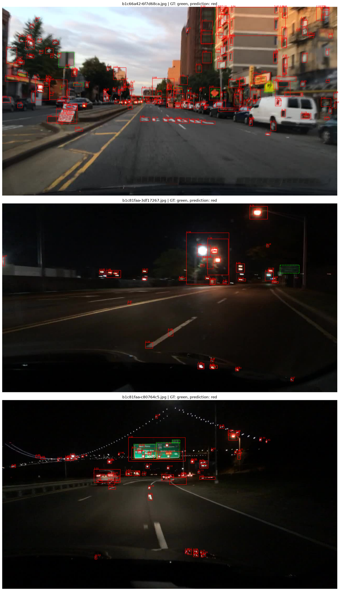
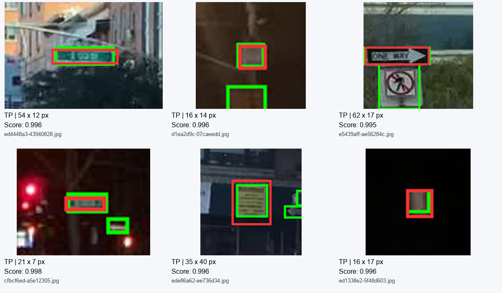
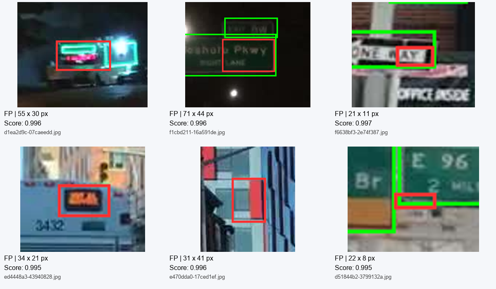
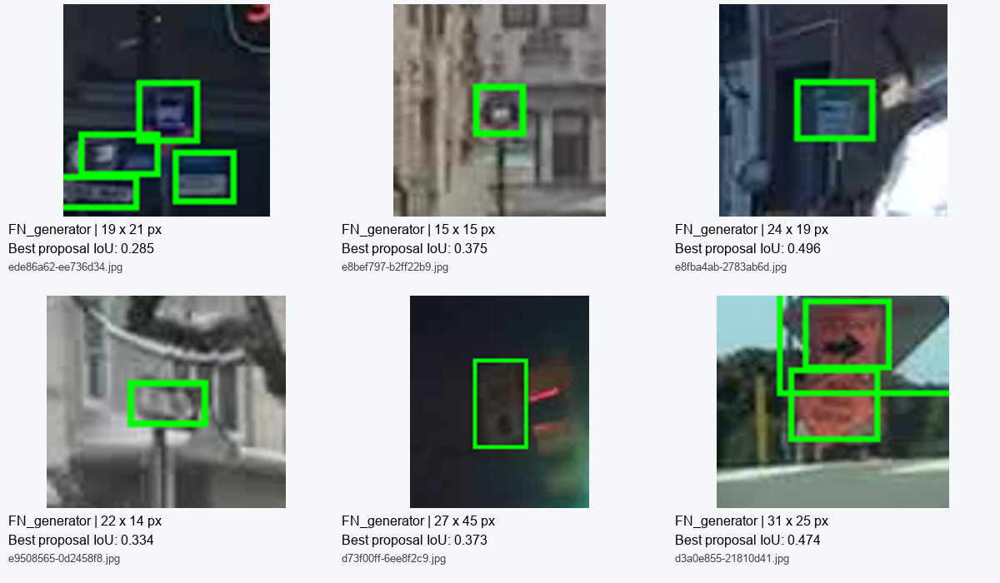
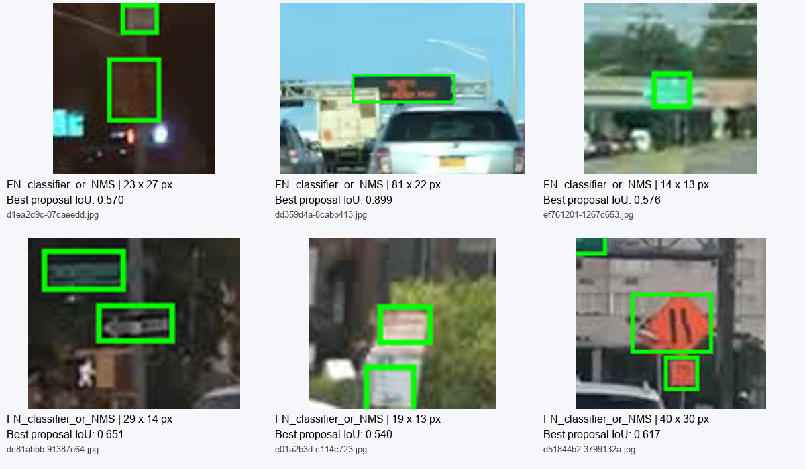

# Traffic Sign MD Classifier

## Scope and evidence

This report records the progression from the first traffic-sign solution to the candidate-focused experiments and the final CatBoost classifier. It explains what was changed, why it was changed, what the saved results show, and which ideas remain unimplemented.

The primary sources are `solution.ipynb`, `history_shit.ipynb`, `candidates.ipynb`, and `final_solution.ipynb`, together with their saved outputs and CSV files. The report describes traffic-sign detection only; traffic-light detection and colour classification are separate requirements of the laboratory assignment.

**Important numerical correction:** the first detector's preview F1 was **0.01635**, not 0.16. Its larger validation sweep reached approximately **0.01906**. Precision was below 0.01, whereas recall was approximately 0.33–0.38. The final CatBoost detector reached **F1 = 0.20440** on the recorded 200-image test subset. This is a final score near 0.2, not an improvement of 0.2 percentage points or necessarily an absolute gain of 0.2.

The experiments used different dataset sizes and subsets over time. Their numbers document the development history; they are not a controlled, same-split ablation of every modification.

## 1. First solution: recognise promising regions using classical features

### 1.1 The initial idea

The first solution used two complementary sources of candidate bounding boxes:

1. **HSV colour segmentation.** Convert RGB to HSV and select red, yellow, green-to-blue, and bright low-saturation pixels. Apply morphological closing, extract contours, and surround them with bounding rectangles.
2. **MSER.** Detect connected brightness regions whose area is relatively stable over a range of intensity thresholds. Convert the detected regions into bounding rectangles.

These methods suggested where a sign might be located. They did not decide whether an object was actually a sign. For example, a red car could produce a colour candidate, and lettering on a building could produce an MSER candidate.

The separate historical notebook, `history_shit.ipynb`, preserves an earlier dense sliding-window prototype: examine windows at different locations, scales, and aspect ratios; extract HOG; classify with a linear SVM; then apply NMS. It suffered from many false alarms and limited coverage of small signs. The two-source proposal approach above is the starting point of `solution.ipynb`.

### 1.2 Feature extraction and classification

Each crop was resized to 64 × 64 pixels. The feature vector contained:

- **1,764 HOG features:** gradient orientation histograms built from 8 × 8 cells and overlapping 2 × 2-cell blocks;
- **48 HSV histogram features:** 16 bins for each channel;
- **3 geometry features:** log aspect ratio, relative width, and relative height.

A linear SVM, trained incrementally through `SGDClassifier(loss="hinge")`, distinguished `traffic_sign` from background. Positive examples were exact ground-truth crops; negative examples were random background crops. This was attractive because it was classical, explainable, and practical on a CPU.

### 1.3 Good crop classification did not imply good detection

The saved crop-classification evaluation used the first **200 validation images**, not the training images. It contained 657 positive crops and 1,600 background crops:

| Class | Precision | Recall | F1 |
|---|---:|---:|---:|
| Background | 0.97 | 0.98 | 0.97 |
| Traffic sign | 0.95 | 0.92 | 0.93 |

Overall crop accuracy was approximately 0.96. However, the detector had to find suitable crops itself. On a three-image validation preview, it produced **3 TP, 354 FP, and 7 FN**, giving precision **0.00840**, recall **0.30000**, and F1 **0.01635**.



*Early output from the first solution. Green denotes reference boxes and red denotes predictions. Recognising prepared crops was much easier than searching a complete scene.*

### 1.4 Why the discrepancy occurred

Two problems were mixed together:

- **Proposal coverage:** a missed candidate could never be recovered by the classifier. The initial candidate recall was approximately **43.28%** on 20 validation images at IoU ≥ 0.5.
- **Training–inference mismatch:** exact sign crops and random background differed from real proposals, which could contain a partial sign, additional background, advertisements, windows, or only lettering.

Threshold tuning could change the precision–recall trade-off but could not create missing candidates. The first solution's validation sweep reached F1 **0.01906** at SVM threshold 2.0 and NMS IoU threshold 0.3, with precision **0.00981** and recall **0.33474**. The recorded larger test result was F1 **0.01893**, precision **0.00974**, and recall **0.33227**.

This evidence motivated a separate investigation of the proposal stage before further classifier changes.

## 2. Work on candidates: measure whether signs are reachable

### 2.1 Separate the two stages

A new notebook evaluated candidates independently of classification. For every ground-truth sign, it computed the maximum IoU against **all** candidate boxes in the same image:

```text
best_iou(sign) = max(IoU(sign, candidate) for candidate in image_candidates)
covered(sign) = best_iou(sign) >= evaluation_threshold
```

A sign was counted once even if many candidates matched it. A box containing several signs was not automatically a good proposal: its IoU with each individual sign could still be poor.

The main quantity was **candidate recall**: covered ground-truth signs divided by all ground-truth signs. Candidate count per image was tracked alongside it, because generating enormous numbers of boxes can raise coverage while making classification harder.

### 2.2 Add geometry-based candidate sources

We retained HSV and MSER and added:

- **Shape contours:** Canny edges at two threshold pairs, morphological closing, polygon approximation, convexity, and circularity. Candidate shapes included triangles, quadrilaterals, octagons, and sufficiently rounded contours.
- **Line pairs:** probabilistic Hough line segments; approximately parallel pairs with sufficient projected overlap could define a candidate rectangle. At most 150 of the longest segments were retained in this implementation.

The aim was to find signs missed by colour and brightness-region heuristics. A rectangle-like sign might have a useful edge outline even when its colour mask was fragmented.

On a fixed 100-image training sample containing **353 signs**:

| Candidate pool | Covered at IoU ≥ 0.5 | Coverage | Candidates/image |
|---|---:|---:|---:|
| HSV + MSER | 142 / 353 | 40.23% | 713.0 |
| HSV + MSER + shapes | 183 / 353 | 51.84% | 1,486.0 |
| Above + lines (`Original_All`) | 192 / 353 | 54.39% | 1,907.9 |

### 2.3 Examine a less strict IoU threshold

At IoU ≥ **0.33**, the same original four-method candidate pool covered **246 / 353 signs = 69.69%**, leaving 107 missed signs. No new boxes were generated: only the coverage criterion changed.

IoU is intersection area divided by union area. It is not the fraction of the ground-truth sign lying inside a proposal. A huge box may contain an entire sign yet still have low IoU.

We kept IoU ≥ **0.5** as the primary detection criterion required by the assignment. IoU ≥ 0.33 served as a supplementary diagnostic for approximate localisation.

### 2.4 Inspect missed signs before adding more methods

Visual inspection highlighted small signs, low-contrast night scenes, narrow street-name plates, and fragmented or composite sign regions. Blue hues and rounded shapes were already represented in the generator; their presence among failures did not mean those categories had never been searched. There was no dedicated black-colour mask, although MSER and edge-based methods could still propose dark regions.

These observations motivated four additional sources:

| Addition | Purpose | Implementation idea |
|---|---|---|
| CLAHE | Recover low local contrast | Enhance luminance locally, then rerun colour/MSER/shape extraction |
| Adaptive thresholding | Find signs under uneven illumination | Local Gaussian thresholds in both polarities; several closing kernels |
| Grouping adjacent regions | Reconstruct fragmented signs | Merge suitably aligned neighbouring HSV/MSER rectangles |
| 2× image search | Improve small-region extraction | Run MSER and shape search on an enlarged image, then map boxes back |

Upscaling cannot recreate missing visual information. It changes the numerical conditions under which the existing region algorithms operate.

### 2.5 Candidate coverage improved substantially

| Combined pool on the same 353-sign sample | IoU threshold | Covered | Coverage |
|---|---:|---:|---:|
| Original four methods | 0.50 | 192 | 54.39% |
| Expanded pool | 0.50 | **310** | **87.82%** |
| Original four methods | 0.33 | 246 | 69.69% |
| Expanded pool | 0.33 | **341** | **96.60%** |

The expanded pool generated approximately **23,658 candidates per image**. This was a deliberate coverage-first compromise, not a free improvement: a much stronger rejection stage was now necessary.

## 3. Train on generated crops, not ideal crops

The next decision was to make the training inputs match the detector's actual inputs. On training images, run the same candidate generator used at inference. Label candidates using ground-truth boxes:

| Maximum IoU with any ground-truth sign | Training label |
|---|---|
| ≥ 0.5 | Traffic sign |
| < 0.2 | Background |
| 0.2–0.5 | Ignore as ambiguous |

Ground truth determined the label; it did not supply the crop. This eliminated the earlier dependence on perfectly aligned positive training crops.

All positive candidates were retained, with up to **60 randomly selected negative candidates per training image**. Across 70,000 training images, the saved counts were **2,330,350 positives** and **4,200,000 negatives**. These are candidate crops, not unique physical signs.

Features were cached per image. Preparation was parallelised across CPU processes, with one OpenCV thread per worker. Atomic temporary-file replacement and recovery from incomplete or corrupt archives were introduced so interrupted runs could resume without discarding valid work.

### 3.1 The linear classifier remained too permissive

On 50 validation images, candidate-level classification at the default score threshold retained high sign recall but extremely low precision: the saved report showed traffic-sign precision around **0.01**, recall **0.92**, and F1 around **0.01**.

After threshold tuning, the best listed detection result on that validation sample was:

| Threshold | Precision | Recall | F1 | TP | FP | FN |
|---:|---:|---:|---:|---:|---:|---:|
| 2.0 | 0.04150 | 0.36283 | 0.07448 | 41 | 947 | 72 |

An additional 200-image test experiment in `candidates.ipynb` recorded candidate recall **84.75%**, detection precision **0.04550**, recall **0.30818**, and F1 **0.07929**. This used a different test sample from the final CatBoost experiment.

The generator could now reach many signs, but the linear classifier could not reject enough difficult background proposals.

## 4. Feature analysis, class balance, and nonlinear boosting

### 4.1 Evaluate usefulness rather than merely adding features

The existing vector already contained **1,815 features**. Therefore, a larger vector alone was not a convincing solution. We examined:

- **SVM coefficients:** the response to a unit change in a feature, with sign indicating the direction of influence;
- **Mean absolute contribution:** average absolute `weight × feature_value` on a sample;
- **Permutation importance:** the reduction in average precision after shuffling individual features or complete HOG/HSV/geometry groups.

Coefficient magnitude alone is not a scale-independent importance measure. Correlated features can substitute for one another, and the ranking reflects the fitted SVM rather than an intrinsic ranking for every future model.

The final notebook selected the first 128 ranked feature indices, sorting by available `AP_drop` and mean absolute contribution, and retained HSV and geometry indices. It then added **48 GLCM features**. GLCM used 32 grey levels, distances 1 and 2, four angles, and six properties: contrast, dissimilarity, homogeneity, energy, correlation, and ASM.

LBP and spatial colour histograms were explored as possible additions in the experimental notebook, but they are **not part of the recorded final CatBoost feature pipeline**.

### 4.2 Balance by generating transformed crops

The class imbalance was approximately 1:1.8 over the full cached dataset; a smaller 150,000-row boosting sample was more skewed, with approximately 42,000 positive versus 107,000 negative examples reported during development. Neither imbalance alone proved the cause of poor detection: the natural candidate stream was vastly more background-heavy.

We first considered random oversampling of feature rows, then rejected it in favour of **pixel-space augmentation**:

- small rotations up to ±7°;
- light crop perturbations;
- brightness and contrast changes;
- weak Gaussian noise;
- occasional Gaussian blur;
- optional horizontal reflection, disabled by default in the final notebook.

We did not use 90° rotations by default because they are usually not representative of upright road-sign scenes. Ground-truth-perfect crops were not reintroduced: augmentation was applied to candidate crops. Features were recomputed from transformed pixels, keeping the original proposal geometry as contextual metadata.

The target was **4,200,000 samples per class**, preserving all original cached candidates and adding **1,869,650 transformed positive samples** in the recorded full-data setup. Balancing is a training intervention; it does not make sign probabilities calibrated for the much rarer positive class at inference.

### 4.3 Why CatBoost

A histogram-gradient-boosting experiment preceded the final notebook. CatBoost was selected for the separate final solution to model nonlinear relationships and interactions between shape, colour, geometry, and texture. All supplied features were numerical; no categorical-feature treatment was required.

The recorded setup used 500 iterations, depth 6, learning rate 0.08, L2 leaf regularisation 5, and six CPU threads. The classification threshold was chosen on validation by detection F1, rather than assumed to be 0.5.

## 5. Final evaluation: distinguish coverage, classification, and detection

### 5.1 Candidate coverage on 200 test images

The final recorded test subset contained **690 reference signs**:

| Candidate criterion | Covered signs | Coverage |
|---|---:|---:|
| IoU ≥ 0.50 | 595 / 690 | **86.23%** |
| IoU ≥ 0.33 | 668 / 690 | **96.81%** |

At the required IoU threshold, only **95 signs** were unreachable before classification. This confirmed that candidate generation was no longer the dominant source of misses.

### 5.2 Candidate-level classification

At the selected confidence threshold **0.995**, the saved evaluation considered **4,522,552 non-ambiguous candidates**:

| Accuracy | Sign precision | Sign recall | Sign F1 |
|---:|---:|---:|---:|
| 0.99836 | 0.64768 | 0.09537 | 0.16625 |

The high accuracy is dominated by background and should not be mistaken for strong sign detection. Candidates with IoU between 0.2 and 0.5 were excluded from this classification table.

### 5.3 End-to-end detection

After confidence filtering and NMS, boxes were matched one-to-one to ground truth at IoU ≥ 0.5:

| Precision | Recall | F1 | TP | FP | FN |
|---:|---:|---:|---:|---:|---:|
| **0.42273** | **0.13478** | **0.20440** | **93** | **127** | **597** |

This substantially improved precision and F1 compared with the linear detector, but recall remained low. The final test F1 was about **0.204**, while the selected validation setting achieved **0.23448** on 50 validation images.



*True positives. Green: ground truth. Red: prediction. These are actual test examples, not generated illustrations.*

### 5.4 Why confidence threshold 0.995 was selected

The validation sweep illustrates the trade-off:

| Confidence threshold | Precision | Recall | F1 |
|---:|---:|---:|---:|
| 0.500 | 0.00382 | 0.76991 | 0.00759 |
| 0.950 | 0.04662 | 0.45133 | 0.08451 |
| 0.980 | 0.12745 | 0.34513 | 0.18616 |
| **0.995** | **0.53125** | **0.15044** | **0.23448** |

The best F1 among the tested settings was obtained by rejecting most proposals. Lower thresholds recovered signs but produced very many false alarms. A finer validation-only search near 0.98–0.995 remained a reasonable follow-up; these numbers do not establish that 0.995 is a global optimum.

## 6. Understand the remaining false positives and false negatives

### 6.1 Evaluation does not require a perfect match

IoU is `intersection / union`. A prediction does not have to exactly equal the annotation. With matching centres and aspect ratios, a prediction 20% larger in both dimensions has IoU about 0.69; one 40% larger has IoU about 0.51.

Predictions are processed in descending confidence. Each ground-truth box can be assigned at most once. A prediction with no eligible match is an FP, and an unmatched ground-truth sign is an FN.

An inaccurate crop of the correct object can therefore produce **both** one FP and one FN. Multiple predictions of the same sign can produce duplicate FPs. However, this does not establish that most FPs are acceptable signs: that requires an explicit error-category audit.



*FP examples. A red box may indicate background, a duplicate, or a sign-like fragment whose localisation does not satisfy the reference-box criterion. The saved label alone does not distinguish these causes.*

### 6.2 Attribute missed signs to the correct stage

| Error source | Number |
|---|---:|
| No candidate with IoU ≥ 0.5 | **95** |
| Suitable candidate existed, but no final match survived | **502** |
| Total false negatives | **597** |

The second row combines classification, NMS, and final matching effects. It must not be described as 502 classifier rejections without further diagnostics.



*Generator misses. Green reference boxes show signs for which every candidate had IoU below 0.5. The displayed value is the best candidate IoU, not classifier confidence.*



*Classifier/NMS/matching misses. These include small and dark signs but also visible daytime examples. A suitable candidate existed. The displayed IoU describes that pre-classification candidate, not the confidence of the final prediction.*

### 6.3 Why an internal symbol can be detected instead of the whole sign

A green direction board may contain a high-contrast pictogram. The classifier can assign the pictogram a high score although the annotation covers the full board. Conversely, an oversized proposal may include the sign and excess background. Both can fail localisation even when the model has recognised sign-like content.

Standard IoU-NMS does not reliably eliminate deeply nested boxes: a small box can be almost entirely inside a large one yet have low IoU with it. A separate containment measure, `intersection / smaller_box_area`, can identify nesting, but it cannot decide which box is semantically correct.

## 7. Proposed next steps: smarter selection, not a flattering metric

The aim is to improve which boxes are retained, while keeping the assignment's IoU ≥ 0.5 evaluation unchanged.

1. **Add diagnostic fields for every FN:** best pre-classification IoU; highest score among geometrically valid candidates; survival after thresholding; survival after NMS; and final matching status.
2. **Classify FPs by cause:** background, duplicate, partial sign, oversized box, and possible annotation ambiguity. A visually plausible box is not automatically a correct reference match.
3. **Try containment-aware suppression.** Compare standard NMS with rules for nested boxes. Prefer an enclosing box only if it is itself supported by the classifier and plausible boundary evidence; do not automatically keep the largest box.
4. **Consider a localisation-quality model.** Train on generated train candidates with target equal to their maximum IoU against ground truth. At inference, combine sign confidence with predicted box quality to rank whole-sign candidates above internal symbols. No ground-truth information may enter inference ranking.
5. **Mine difficult training negatives.** Revisit highly scored background and misleading sign fragments. Candidates in the previously ignored IoU band need careful treatment; simply declaring every partial sign background may also hurt recall.
6. **Test local box refinement.** Search nearby enclosing or slightly resized candidates around an accepted fragment, then rerank. This can use an existing complete candidate without regenerating the whole scene.
7. **Retune confidence and suppression jointly on validation.** Lower confidence thresholds generally reduce FN but increase FP. Raising confidence generally does the reverse.

These are proposed experiments, not completed improvements. Their benefit must be demonstrated on validation before applying fixed settings to a fresh held-out evaluation.

## 8. Reproducibility and limits

- Training uses generated candidates from train images; validation/test data are not augmented into training.
- Test examples were inspected repeatedly during development. The reported test scores therefore describe an explored development subset rather than a pristine, untouched final benchmark. A fresh held-out subset is needed for an independent final claim.
- The final feature selection depends on the saved importance CSV from the earlier experiment. It is not a universal ranking of feature usefulness.
- Training balance does not match inference prevalence: the detector evaluates thousands of background candidates per image. Accuracy and balanced-crop metrics alone are inadequate.
- Augmentation, candidate coverage, classifier quality, confidence calibration, suppression, and localisation must be assessed separately. No single change has been isolated as the cause of every improvement.
- Figures are crops from the recorded BDD100K test images, with boxes reconstructed from saved predictions/error records and original JSON annotations. Filenames and dimensions are shown for traceability. Images have been enlarged for inspection; enlargement does not improve their original resolution.

## Recorded outcome

The development successfully increased proposal coverage from roughly 40–54% to about 86–88% at IoU ≥ 0.5 on the recorded subsets. The final CatBoost pipeline achieved test detection **F1 = 0.20440**, with much better precision but low recall at a strict confidence threshold. The next priority is to distinguish classifier rejection from localisation and suppression errors, and to improve whole-sign box selection rather than only increasing the number of proposals or relaxing the reported metric.
